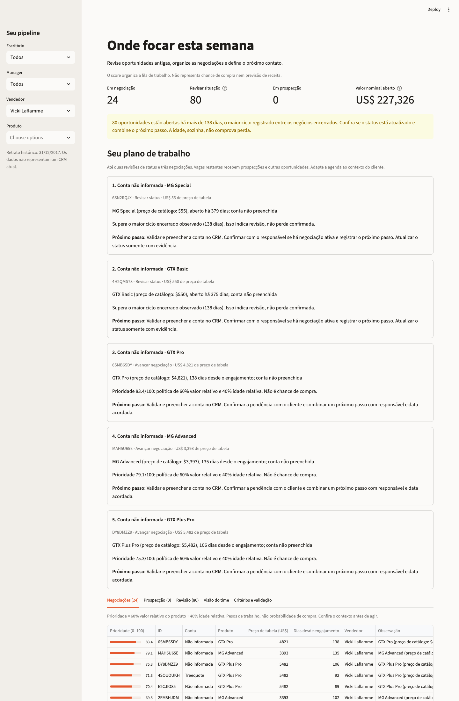
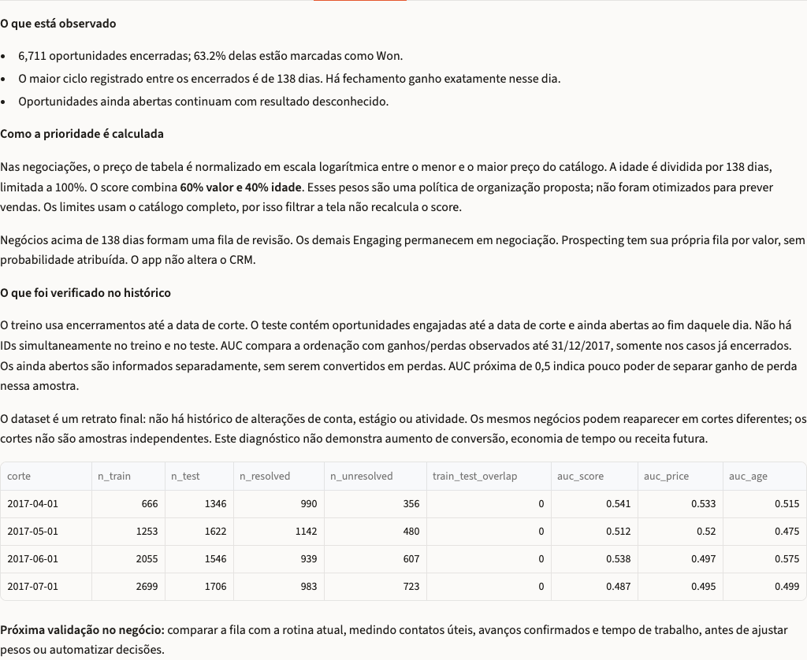

# Submissão — Fellipe Saraiva — Challenge 003 (Lead Scorer)

- **Nome:** Fellipe Saraiva
- **LinkedIn:** [linkedin.com/in/saraivaai](https://www.linkedin.com/in/saraivaai/)
- **Challenge escolhido:** 003 — Lead Scorer

## Executive Summary

**Abra sua carteira e saiba quais oportunidades revisar e quais negociações trabalhar primeiro.** Construí um app Streamlit que transforma o pipeline em um plano de até cinco ações por vendedor, com critérios visíveis. No recorte de 31/12/2017, há 2.089 oportunidades abertas: 1.291 negociações ultrapassam o maior ciclo de fechamento registrado e pedem revisão de situação, 298 permanecem dentro dessa referência e 500 estão em prospecção. A priorização combina valor de catálogo e idade da negociação; o score é uma regra de trabalho, não uma probabilidade de compra. A recomendação é usar o plano para confirmar próximos passos com os clientes e atualizar o CRM com base nas respostas.



## Como rodar

Requer Python 3.11 ou superior. A partir da raiz deste repositório:

```bash
cd submissions/fellipe-saraiva/solution
python3 -m venv .venv
source .venv/bin/activate
pip install -r requirements.txt
python -m unittest discover -s . -p 'test_*.py'
python scoring.py
streamlit run app.py
```

Abra [localhost:8501](http://localhost:8501). No Windows, ative o ambiente com `.venv\Scripts\activate` em vez de `source`.

Os quatro CSVs estão incluídos em [`solution/data/`](solution/data/). A fonte indicada no desafio é [CRM Sales Predictive Analytics, no Kaggle](https://www.kaggle.com/datasets/agungpambudi/crm-sales-predictive-analytics), descrita no brief como CC0. O relato original registra obtenção por um espelho do GitHub; a URL desse espelho não foi preservada, portanto a cadeia de download não foi verificada nesta revisão. O app usa uma **data de referência fixa: 31/12/2017**, e não a data atual do computador.

## O que o vendedor recebe

1. **Uma visão da carteira:** oportunidades em negociação, em prospecção e que precisam de revisão, com o denominador de cada indicador explícito.
2. **Um plano de até cinco ações:** ao selecionar o vendedor, o app reserva até duas posições para revisão e três para negociação; preenche vagas com prospecções e, se ainda houver espaço, com os itens restantes das duas filas. Cada item informa o fato observado, o motivo da prioridade e um próximo passo sugerido.
3. **Uma lista explicável:** score, preço de catálogo, idade e orientação de ação. Campos incompletos viram tarefas de cadastro, sem inferir intenção de compra.
4. **Filtros por vendedor, manager e região:** o vendedor consulta sua carteira; a gestão identifica onde precisa confirmar o estado das oportunidades.
5. **Critérios e avaliação à vista:** a tela explica a fórmula e mostra o backtest temporal, incluindo os casos cujo desfecho permanece desconhecido.

O app apoia a decisão. Confirmar interesse, combinar uma data e alterar o estágio no CRM continuam dependendo do contato e da avaliação do vendedor.

## Critérios de priorização

**Primeiro, separar o tipo de trabalho.** O maior ciclo entre negócios encerrados até a data de referência é 138 dias. Uma negociação aberta **há mais de 138 dias** entra na fila de revisão de situação. Esse limite descreve o histórico disponível; não é prazo comercial, nem prova de perda. Há um negócio ganho exatamente no dia 138, e os dez abertos com essa idade permanecem na fila de negociação.

**Depois, ordenar as negociações por uma regra transparente:**

```text
score = 100 × (0,60 × valor normalizado + 0,40 × idade relativa)
idade relativa = mínimo(idade em dias / maior ciclo histórico, 1)
```

O valor usa escala logarítmica e limites fixos do catálogo de produtos. Isso reduz a dominância dos produtos mais caros e mantém o score estável quando um filtro muda. A idade relativa dá visibilidade às negociações mais antigas dentro do histórico. Os pesos de 60% e 40% são uma escolha de produto, aberta a ajuste; não foram estimados como probabilidades de ganho.

**A idade muda a prioridade mesmo com o preço constante:** para o mesmo produto, passar de 20 para 120 dias acrescenta cerca de 29 pontos ao componente total do score, usando a referência de 138 dias. Esse incremento significa maior prioridade de acompanhamento segundo a regra, não maior chance de fechar.

- **Revisão:** confirmar se a oportunidade continua ativa e registrar o próximo passo; encerrar somente quando houver evidência de encerramento.
- **Negociação:** esclarecer a pendência com o cliente e combinar a próxima ação. A prioridade não cria um prazo de compra.
- **Prospecção:** fila própria, ordenada por valor de catálogo, com orientação para primeiro contato. A base não permite reconstruir a taxa de passagem de prospecção para engajamento.
- **Cadastro incompleto:** identificar ou confirmar a conta antes de usar seus dados em uma abordagem.

Preço de catálogo não equivale a receita contratada. A versão atual não calcula forecast financeiro nem atribui probabilidade individual de fechamento.

## Avaliação temporal e limites de interpretação

O backtest usa quatro datas de corte. Para cada uma, o histórico de referência contém apenas negócios encerrados **até a data de corte**. O conjunto elegível contém oportunidades engajadas **até o corte** e ainda abertas ao fim daquele dia. A AUC usa somente as que encerraram **depois do corte**, com resultado conhecido até 31/12/2017. Os IDs de treino e teste não se sobrepõem. Oportunidades que permanecem abertas são contabilizadas separadamente como desfecho desconhecido, sem receber rótulo de perda.

`python scoring.py` reproduz as contagens e a tabela de avaliação. AUC mede a ordenação entre ganhos e perdas na parte observável da amostra; 0,5 indica ausência de discriminação nessa métrica.

| Corte de 2017 | Elegíveis | Desfecho conhecido | Ainda abertos | AUC do score | AUC por preço |
|---|---:|---:|---:|---:|---:|
| 01/04 | 1.346 | 990 | 356 | 0,541 | 0,533 |
| 01/05 | 1.622 | 1.142 | 480 | 0,512 | 0,520 |
| 01/06 | 1.546 | 939 | 607 | 0,538 | 0,497 |
| 01/07 | 1.706 | 983 | 723 | 0,487 | 0,495 |

O score **não supera consistentemente a ordenação por preço** nesse diagnóstico. Sua proposta é explicitar uma política de acompanhamento que combina valor e idade, com uma fila separada para revisar status. O script também informa o tamanho do histórico, a AUC por idade e a interseção de IDs entre treino e teste — zero nos quatro cortes. Os mesmos negócios podem reaparecer em cortes diferentes; as quatro linhas não são amostras independentes.

Essa avaliação verifica o comportamento retrospectivo da regra. **Não demonstra aumento de vendas nem valida os pesos como política ótima.** Dados sem histórico de atividades e sem snapshots dos cadastros limitam o que pode ser reconstruído. O app apresenta o score como ferramenta de organização, sem transformá-lo em certeza sobre cada cliente.



### Validação realizada em 14/10/2026

Passaram **20 testes automatizados** (16 de scoring e quatro de interface com AppTest), além das verificações Ruff e Black. O layout foi conferido em desktop (1440 × 1100) e celular (390 × 844), sem rolagem horizontal da página no celular. No navegador desktop, não houve erros de JavaScript; o filtro de Vicki mostrou 24 negociações, 80 revisões e nenhuma prospecção. O download real da fila gerou um CSV com 24 linhas, todas de Vicki, contendo prioridade, observação, critério e próximo passo. A [saída dos testes e do backtest](process-log/validacao.txt) está incluída. Essa validação confirma o funcionamento nos cenários testados; o impacto comercial ainda precisa ser medido em uso real.

## Próximo uso recomendado

Começar com uma carteira, revisar a situação dos itens sinalizados e registrar próximo contato, pendência e responsável. Para avaliar utilidade comercial, acompanhar ações concluídas, qualidade da atualização do CRM e resultados posteriores, comparando com a rotina anterior sob condições definidas. Para escalar, seriam necessários integração com o CRM, histórico de atividades, registro das decisões e validação dos critérios com o time comercial.

## Como usei IA

O [process log](process-log/README.md) preserva a evolução e identifica quais conclusões anteriores foram revistas.

| Ferramenta | Uso no processo |
|---|---|
| Warp, agente Oz | v1 e v2: exploração, primeiro scoring e backtests, conforme narrativa original |
| Claude | v3: revisão do modelo e da interface, conforme narrativa original |
| Codex | v4: correção da fronteira temporal, substituição das perdas presumidas por revisão de situação e alinhamento entre código e apresentação |
| SARAIVA · PNL e SARAIVA · Conversão BR | Revisão de linguagem: separar observação de interpretação e vincular benefício, prova e próxima ação |

O método Doug orientou a proposta inicial de diagnóstico e ação. A revisão preserva a ação concreta e troca consequências presumidas por perguntas e decisões sustentadas no CRM.

## Evidências incluídas

- [Código e dados](solution/), com comandos de execução e testes acima.
- [Screenshots do app](docs/).
- [Narrativa do processo](process-log/README.md), formato aceito pelo guia de submissão.
- [Saída da validação automatizada](process-log/validacao.txt).

A submissão está preparada para revisão por Pull Request. Este documento não registra um envio já realizado.
