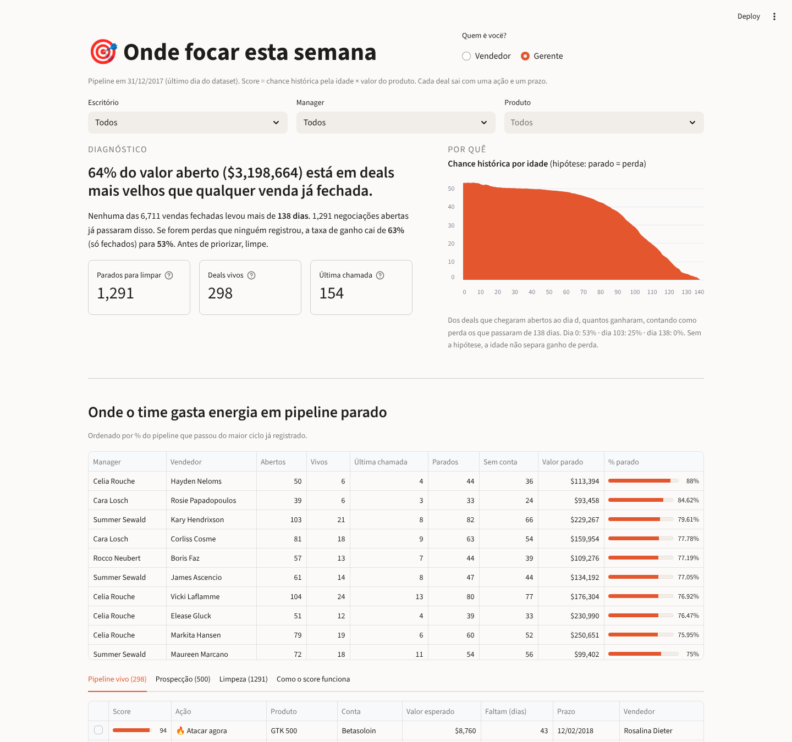
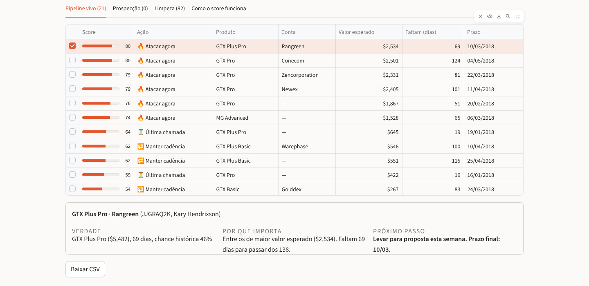

# Submissão — Fellipe Saraiva — Challenge 003 (Lead Scorer)

- **Nome:** Fellipe Saraiva
- **LinkedIn:** [linkedin.com/in/saraivaai](https://www.linkedin.com/in/saraivaai/)
- **Challenge escolhido:** 003 — Lead Scorer

## Executive Summary

**64% do valor aberto no pipeline ($3,2 milhões de $5,0 milhões) está em deals mais velhos que qualquer venda já fechada.** Nenhuma das 6.711 vendas fechadas levou mais de 138 dias, mas 1.291 negociações abertas já passaram disso. Se forem perdas que ninguém registrou, a taxa de ganho real cai de 63% para 53%.

Construí um app Streamlit que o vendedor abre na segunda e recebe **5 comandos em ordem, cada um com prazo**. Os deals parados saem do ranking e viram uma tarefa de limpeza.

Também testei o que prevê ganho. Nem vendedor, nem produto, nem setor, nem conta, nem o próprio score separam ganho de perda de forma estável (AUC ≈ 0,5). A idade oscila e muda de direção entre cortes. Por isso o app não promete adivinhar quem compra. Ele organiza a semana: **limpar o que passou do prazo, trabalhar o que vale mais e o que vence antes.**


## Como rodar

Requer Python 3.11 ou superior.

```bash
cd submissions/fellipe-saraiva/solution
python3 -m venv .venv && source .venv/bin/activate     # Windows: .venv\Scripts\activate
pip install -r requirements.txt
python -m unittest discover -s . -p 'test_*.py'        # 23 testes
python scoring.py                                      # reproduz todos os números deste README
streamlit run app.py                                   # http://localhost:8501
```

Os quatro CSVs do [dataset do Kaggle](https://www.kaggle.com/datasets/agungpambudi/crm-sales-predictive-analytics) estão em `solution/data/`. Eles foram baixados de um espelho no GitHub, porque o Kaggle exige login. As contagens batem com o brief, mas a URL do espelho não foi guardada. O app usa uma **data de referência fixa, 31/12/2017** (último dia da base), e não a data de hoje.

## O que cada pessoa vê

O app abre perguntando: **Vendedor ou Gerente?**

**Vendedor** (escolhe o próprio nome):
1. **"Bom dia, Kary."** Quatro números: deals vivos, Última chamada, parados para limpar e o valor parado.
2. **Alertas com comando:**
   - 25% ou mais dos deals abertos parados: o app manda resolver até sexta (requalificar com data do cliente ou marcar Lost).
   - Abaixo de 25%, o app diz "Pipeline limpo. Agora ataque". Hoje ninguém passa nesse critério: o mais limpo tem 38% parado.
   - Deal vivo sem conta no CRM: "preencher a conta antes de tudo".
3. **Seus 5 comandos da semana**, em cartões. Cada cartão traz:
   - Valor esperado, chance histórica e **prazo final**.
   - Uma barra de contagem regressiva.
   - O comando em destaque e o porquê.

   A Última chamada mais valiosa (que ainda tenha pelo menos 1 dia de prazo) sempre entra no plano. Deal parado nunca entra.
4. **Tabela enxuta.** Ao **clicar numa linha**, aparece a explicação completa: **Verdade → Por que importa → Próximo passo**.

**Gerente** (filtros por escritório, manager e produto):
1. **Diagnóstico:** o valor parado, ao lado da curva "quanto mais velho o deal, menos ele fecha".
2. **Pipeline parado por vendedor**, com % e valor. O primeiro da lista tem 88% dos deals abertos parados.
3. As mesmas filas, com a coluna Vendedor.

| Gerente | Detalhe do deal (clique na linha) |
|---|---|
|  |  |

## Lógica do score

| Passo | Regra |
|---|---|
| Prazo | O maior ciclo entre os fechados é **138 dias**. Engaging com **mais** de 138 dias vira **Requalificar ou encerrar** (sai do ranking). O dia 138 ainda está no prazo: existe uma venda fechada exatamente nele. |
| Chance histórica | Dos deals da base que chegaram abertos à mesma idade, quantos ganharam: 53% no dia 0, 48% no dia 60, 37% no dia 90, 25% no dia 103, 11% no dia 120. **Hipótese explícita:** os parados contam como perda, e é ela que produz a queda. Entre os desfechos registrados, a idade não separa ganho de perda; sem a hipótese, só existe a taxa dos fechados (63%). |
| Valor esperado | Chance histórica × preço de catálogo. Deal aberto não tem `close_value`, e o deal ganho fecha na mediana a 100% do preço de tabela. |
| Score 0–100 | Escala log do valor esperado. Os limites vêm do catálogo inteiro, então filtrar a tela não muda o score. |
| Ações | **Última chamada** = vivo a partir do dia 103, quando a chance cai abaixo da metade da média. **Atacar agora** = score ≥ 70. **Manter cadência** = score ≥ 45. **Baixa prioridade** = o resto. **Fazer 1º contato** = Prospecting. |
| Desempate | Dentro do mesmo score, vem antes quem vence antes. |
| Deal sem conta | Todo deal fechado da base tem conta, e 209 dos 298 vivos estão sem conta. Pode ser regra do CRM no fechamento, então isso não entra na chance: vira o primeiro comando. |

**A idade muda a ordem, não só o preço.** Um GTX Pro de $4.821 no dia 120 vale $521 esperados e perde para um GTX Plus Basic de $1.096 no dia 20 ($554). Mesmo assim, o preço ainda pesa muito: a correlação de ordem entre score e preço é 0,78 entre os vivos.

## O backtest: o que tem sinal e o que não tem

Em 4 datas de corte, o modelo aprende só com o que tinha fechado **até o corte** e é avaliado nos deals **abertos ao fim daquele dia**. O rótulo é o desfecho **registrado** até 31/12. Os deals que seguem abertos ficam fora da AUC e são contados à parte; nenhum vira perda presumida. Nenhum ID aparece no treino e no teste ao mesmo tempo.

| Corte (2017) | Abertos no corte | Com desfecho | Ainda abertos | Score | Idade | Preço | Vendedor | Produto | Setor | Conta |
|---|---:|---:|---:|---:|---:|---:|---:|---:|---:|---:|
| 01/04 | 1.346 | 990 | 356 | 0,53 | 0,47 | 0,53 | 0,50 | 0,45 | 0,48 | 0,47 |
| 01/05 | 1.622 | 1.142 | 480 | 0,52 | 0,54 | 0,52 | 0,46 | 0,49 | 0,47 | 0,48 |
| 01/06 | 1.546 | 939 | 607 | 0,49 | 0,43 | 0,50 | 0,48 | 0,51 | 0,49 | 0,49 |
| 01/07 | 1.706 | 983 | 723 | 0,50 | 0,55 | 0,50 | 0,50 | 0,53 | 0,51 | 0,47 |

**Tudo fica perto de 0,5.** Nenhum atributo desta base separa de forma estável, entre os deals que fecharam, quem ganha de quem perde. A idade chega a 0,43 em um corte e 0,55 em outro: o sinal muda de direção, então não é confiável. Colocar "vendedor: +7 pp" na tela daria uma explicação convincente e falsa.

O que a base mostra com força é outra coisa: **o prazo**. Nenhuma venda fechou depois de 138 dias, e é isso que o app transforma em ação. Os cortes reutilizam deals, então as linhas não são amostras independentes.

## Recomendações

1. **Esta semana:** cada vendedor resolve os seus parados até sexta. Com data de decisão do cliente, o deal é requalificado. Sem data, vira Lost. Só assim o pipeline volta a significar alguma coisa.
2. **Toda segunda:** executar o plano de 5 comandos. "Última chamada" = proposta final com prazo.
3. **No CRM:**
   - Tornar a conta obrigatória na criação do deal.
   - Alertar quando um deal passar de 138 dias.
   - Registrar atividades (último contato, reuniões). É o que falta para algum sinal separar ganho de perda.

## Limitações

- **Sem dados de atividade, nenhum atributo previu ganho.** O score organiza a agenda; ele não prevê receita deal a deal.
- **"Parado = perda" é uma hipótese**, sustentada por 0 fechamentos após 138 dias em 6.711, mas não verificada nos próprios deals parados. Se parte deles tiver sido ganha sem registro, a chance histórica está subestimada.
- **O limite de 138 dias pode ser artefato da base.** Os engajamentos começam em 20/10/2016, mas nenhum deal fechou antes de 01/03/2017, o que sugere dados sintéticos. Em um CRM real, o limite precisa ser recalculado.
- **Prospecting usa a média histórica.** A base não mostra quantas prospecções viram negociação, então na prática essa fila é ordenada por valor.
- **Para escalar:**
  - Ler direto do CRM (API).
  - Recalcular a curva toda noite.
  - Mandar o plano por Slack ou e-mail às 8h de segunda.
  - Medir se os deals trabalhados pelo plano fecham mais que os outros.

## Como usei IA

Narrativa completa, com os erros de cada versão: [process-log/README.md](process-log/README.md). Saída dos testes e do backtest: [process-log/validacao.txt](process-log/validacao.txt).

| Ferramenta | Uso |
|---|---|
| Warp (agente Oz) | v1 e v2: EDA, primeiro scoring, primeiro backtest |
| Claude | v3 e v5: diagnóstico dos deals parados, interface por papel, plano de segunda, testes e auditoria das outras versões |
| Codex | v4: revisão crítica da v3. Corrigiu a fronteira do dia 138 e a sobreposição de treino e teste, separou os desfechos desconhecidos e cortou afirmações que excediam a evidência |
| Doug (meu método de mentoria) | Critério de produto: verdade antes de comando, comando com prazo, elogio só quando merecido |

| Versão | O que era | Por que mudou |
|---|---|---|
| v1 | Modelo com vendedor, produto, setor e conta | AUC 0,51: o modelo explicava ruído |
| v2 | Valor esperado com curva só de fechados | A chance subia com a idade (viés de sobrevivência) e o score virou tabela de preço |
| v3 | Parados como perda, prazo por deal, interface por papel | Afirmava a hipótese como fato, e o backtest tinha sobreposição de treino e teste no dia do corte |
| v4 | Score fixo (60% valor, 40% idade) e nenhuma hipótese | Rigoroso, mas o plano mandava começar por um deal de $55 parado há 379 dias, e a interface voltou a ser uma tabela |
| **v5** | O rigor da v4 com o diagnóstico e a interface da v3 | A hipótese é declarada como hipótese, e o plano prioriza valor e prazo |
